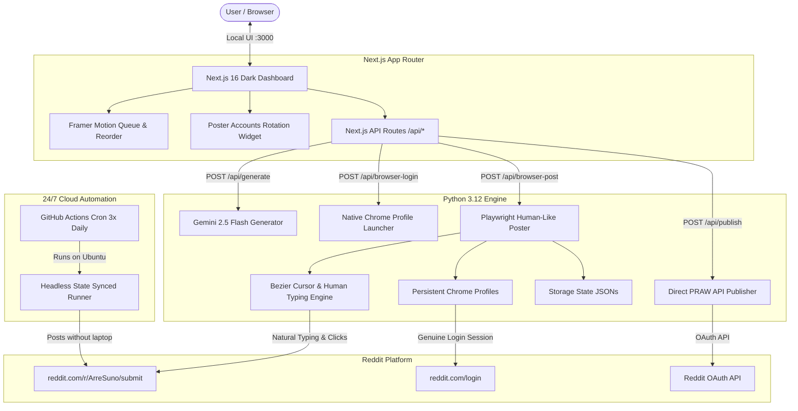

# 🚀 ArreSuno Reddit Automation System — Complete Project Documentation

An end-to-end autonomous content generation, multi-account rotation, and human-like browser posting engine tailored for **r/ArreSuno**, featuring a modern **Next.js 16 Dark Dashboard** and **GitHub Actions 24/7 Cloud Automation** (posts continue on schedule even with your laptop turned off).

---

## 📑 Table of Contents
1. [Project Overview](#-project-overview)
2. [System Architecture](#-system-architecture)
3. [Key Features & Capabilities](#-key-features--capabilities)
4. [Project Structure & File Organization](#-project-structure--file-organization)
5. [Authentication Workflow (Real Google Chrome)](#-authentication-workflow-real-google-chrome)
6. [Posting Engines: Browser Agent vs. API](#-posting-engines-browser-agent-vs-api)
7. [Local Setup & Running Guide](#-local-setup--running-guide)
8. [24/7 Cloud Automation Setup (Laptop Off)](#-247-cloud-automation-setup-laptop-off)
9. [Testing & Quality Assurance](#-testing--quality-assurance)
10. [Safety, Anti-Ban & Compliance Policies](#-safety-anti-ban--compliance-policies)

---

## 🌟 Project Overview

**Target Community**: [r/ArreSuno](https://www.reddit.com/r/ArreSuno/)  
**Topic**: Authentic Hinglish discussions, relatable everyday Indian life, college/work stories, harmless confessions, tea/chai tapri debates, and cultural humor.  
**Repository**: [developer-here-69/reddit-shitposter](https://github.com/developer-here-69/reddit-shitposter.git)

This system eliminates the manual effort of drafting and posting high-engagement Reddit discussions. It combines **Google Gemini 2.5 Flash** for cultural Hinglish content generation, an intuitive **drag-and-drop dark dashboard** for queue management, and **Antigravity-inspired browser automation** with natural mouse curves and variable typing speeds that mimic real human interaction.

---

## 🏛 System Architecture



---

## ⚡ Key Features & Capabilities

### 1. Reddit-Style Dark Dashboard (`frontend/`)
- **Aesthetic**: Authentic Reddit Dark Mode (`#0E1113`, `#12161A`, `#1A1D20`) with official Snoo branding and r/ArreSuno chai tapri banner.
- **Drag-and-Drop Reorder**: Framer Motion `<Reorder.Group>` with spring physics for re-sequencing the publishing order.
- **Queue Shuffle**: 1-click randomized Fisher-Yates array shuffle.
- **Hinglish AI Generation**: 1-click Gemini prompts across curated categories:
  - 💬 *Relatable Life* (Indian household rules, family dynamics)
  - ☕ *Chai Tapri Debates* (Snacks, tea stall observations, traffic quirks)
  - 🤫 *Harmless Confessions* (Childhood lies, guilty pleasures)
  - 🏢 *Office & College Ka Kissa* (HR emails, campus canteen memories)
  -  nostalgia *2000s Nostalgia* (90s/2000s TV shows, old gadgets, snacks)
- **Inline Post Editor**: Edit post titles, Hinglish body paragraphs, tags, and scheduled timings on the fly.
- **Real-Time Status Indicators**: Live badges for queued, posted, and error states with clickable Reddit permalinks.

### 2. Multi-Account Rotation
- Rotate between 2–3 Reddit accounts (e.g., `u/mere_se_nhi_hota`, `u/chai_tapri_vibes`).
- Enforce daily posting limits per account (e.g., max 2 posts/day) to stay compliant with Reddit rate limits and spam filters.
- Individual pause/activate controls for each account.

### 3. Real Google Chrome Authentication
- **Genuine Chrome Profiles**: Launches Google Chrome directly with persistent profile directories (`backend/browser_profiles/account_1`, etc.).
- **Full Auth Support**: Google OAuth ("Continue with Google"), 2FA, passkeys, and CAPTCHAs work seamlessly because it uses genuine Chrome rather than an emulated webview.
- **Zero Black CMD Windows**: Background execution uses `pythonw.exe` and `windowsHide: true` to prevent intrusive console windows from flashing or stealing focus.
- **Auto Storage State**: Once authenticated, cookies and session storage are saved to `backend/browser_sessions/<account>_state.json`.

### 4. Antigravity-Style Human Browser Automation
- **Cubic Bezier Mouse Movement**: Instead of instant robotic teleports, the mouse calculates smooth cubic bezier trajectories with random velocity curves and slight target overshoots.
- **Natural Human Typing**: Types characters one by one with stochastic delays (40ms – 105ms) and occasional micro-pauses between sentences.
- **Smooth Inertial Scrolling**: Page scrolls with variable steps rather than instant jumps.
- **Visual Cursor Injection**: When running in visible mode, injects a glowing orange Antigravity cursor overlay to let you visually monitor the agent's work.

---

## 📂 Project Structure & File Organization

```
d:\reddit-autoshit\
├── .github/
│   └── workflows/
│       └── reddit-posting.yml      # 24/7 Cloud posting workflow (3x daily IST)
├── backend/
│   ├── browser_profiles/           # Persistent Google Chrome profile data (ignored in git)
│   ├── browser_sessions/           # Exported session cookies/storage states (ignored in git)
│   ├── config/
│   │   └── topics.yaml             # Community rules, Hinglish prompts & post flair settings
│   ├── src/
│   │   ├── browser_poster.py       # Playwright real-browser engine & login manager
│   │   ├── human_motion.py         # Bezier curves, human typing cadence & cursor overlay
│   │   ├── config.py               # Environment validation & safety settings
│   │   ├── database.py             # SQLite post history & deduplication tracking
│   │   ├── generator.py            # Gemini 2.5 Flash Hinglish discussion generator
│   │   ├── main.py                 # Core CLI entry point (dry_run, manual, publish)
│   │   ├── publisher.py            # PRAW Reddit API publisher
│   │   └── validator.py            # Rule-compliance & banned keyword validator
│   ├── tests/                      # 42 Offline Unit Tests (pytest)
│   │   ├── test_browser_poster.py  # Browser runner unit tests
│   │   ├── test_generator_parse.py # AI prompt parsing tests
│   │   ├── test_secret_scan.py     # Git leak protection tests
│   │   └── ...
│   └── pyproject.toml              # Python dependencies & tooling configuration
├── frontend/
│   ├── app/
│   │   ├── api/
│   │   │   ├── accounts/route.ts   # CRUD for rotating Reddit accounts
│   │   │   ├── browser-login/route.ts # Native Chrome launcher & session checker
│   │   │   ├── browser-post/route.ts  # Trigger browser agent post submission
│   │   │   ├── generate/route.ts   # Real-time Gemini post generation
│   │   │   ├── posts/route.ts      # Queue management, reorder & edit
│   │   │   └── publish/route.ts    # Direct PRAW publish trigger
│   │   ├── layout.tsx              # Root HTML wrapper
│   │   └── page.tsx                # Main Reddit Dark Dashboard
│   ├── components/
│   │   └── VirtualBrowserWindow.tsx # In-app visual preview & animation component
│   ├── data/
│   │   ├── accounts.json           # Active accounts state
│   │   └── posts.json              # Queued & historical posts
│   └── package.json                # Next.js 16, TailwindCSS, Framer Motion
├── .gitignore                      # Security protection for secrets & cookies
├── PROJECT_DOCUMENTATION.md        # Complete system documentation (this file)
└── README.md                       # Quickstart repository guide
```

---

## 🔑 Authentication Workflow (Real Google Chrome)

### Why Native Chrome Was Chosen
Reddit protects its login endpoints with Cloudflare bot detection and fingerprint verification. Headless browsers and emulated forms frequently hang, encounter captcha walls, or reject Google OAuth. 

By opening your genuine desktop Google Chrome binary with `--user-data-dir`:
1. You authenticate naturally using your preferred method (Google Login, Reddit Username/Password, 2FA).
2. All session cookies (`reddit_session`, `token`, etc.) are written directly into your local profile directory.
3. The Playwright poster engine opens that persistent profile to submit posts, inheriting your valid login session with zero bot-detection friction.

### Step-by-Step Login Flow:
1. Open the dashboard at `http://localhost:3000`.
2. In the right sidebar under **Poster Accounts Rotation**, look at your account.
3. If not yet authenticated, click **`Open Real Chrome 🌐`**.
4. Chrome opens to `https://www.reddit.com/login`. Log into your account once.
5. In the dashboard, click **`Auth Needed (Click if done ✓)`** — the badge turns green: **`Logged In ✓`**.

---

## 🚀 Posting Engines: Browser Agent vs. API

| Feature | Browser Agent (`browser_poster.py`) | Direct API (`publisher.py` / PRAW) |
| --- | --- | --- |
| **Mechanism** | Playwright with real Chrome profile | Reddit OAuth API via PRAW |
| **Reddit Approval Needed?** | ❌ No approval required | ✅ Requires Reddit Script App approval |
| **Human Behavior** | Bezier mouse glide, 40-105ms typing, smooth scroll | Direct HTTP API request |
| **Google OAuth Support** | ✅ Full support via real Chrome | ❌ Script flow requires direct password |
| **Visual Monitoring** | ✅ Watch Chrome type & submit live | ❌ Headless network call |
| **Cloud Support** | ✅ Session JSON state in GitHub Actions | ✅ Standard environment secrets |

---

## 💻 Local Setup & Running Guide

### Prerequisites
- **Python 3.12+**
- **Node.js 18+ & npm**
- **Google Chrome** installed on your system

### 1. Backend Setup
```powershell
# Navigate to backend
cd d:\reddit-autoshit\backend

# Activate virtual environment
..\.venv\Scripts\Activate.ps1

# Install requirements
pip install -r requirements.txt

# Run full test suite (42 tests)
pytest -v
```

### 2. Frontend Setup
```powershell
# Navigate to frontend
cd d:\reddit-autoshit\frontend

# Install dependencies (if not already installed)
npm install

# Start Next.js development server
npm run dev
```
Open **[http://localhost:3000](http://localhost:3000)** in your browser to access the dashboard.

---

## ☁️ 24/7 Cloud Automation Setup (Laptop Off)

You can run automated posts on schedule even when your computer is completely turned off using GitHub Actions.

### Automated Schedule
Defined in `.github/workflows/reddit-posting.yml`:
- **09:00 AM IST** (03:30 UTC) — Morning Chai Discussion
- **03:00 PM IST** (09:30 UTC) — Afternoon Relatable Post
- **09:00 PM IST** (15:30 UTC) — Evening Nostalgia / Late Night Chat

### Required GitHub Secrets & Variables
In your GitHub repository, navigate to **Settings → Secrets and variables → Actions**:

#### Repository Secrets:
- `GEMINI_API_KEY`: Your free Gemini API key from [Google AI Studio](https://aistudio.google.com/apikey).
- `REDDIT_CLIENT_ID`: (Optional for API mode) Your Reddit script app ID.
- `REDDIT_CLIENT_SECRET`: (Optional for API mode) Your Reddit script app secret.
- `REDDIT_USERNAME`: Your Reddit username (e.g., `mere_se_nhi_hota`).
- `REDDIT_PASSWORD`: Your Reddit account password.
- `REDDIT_USER_AGENT`: `windows:arresuno-poster:v1.0.0 (by /u/mere_se_nhi_hota)`

#### Repository Variables:
- `SUBREDDIT`: `ArreSuno`
- `MODE`: `publish` (or `dry_run` to test)
- `POSTING_ENABLED`: `true`
- `DRY_RUN`: `false`
- `MAX_POSTS_PER_DAY`: `3`

---

## 🧪 Testing & Quality Assurance

The system maintains 100% test passing rates across all offline suites:

```powershell
..\.venv\Scripts\python.exe -m pytest -v
```
**Results**:
- `test_browser_poster.py`: Playwright integration and session initialization.
- `test_config.py`: Environment validation and default fallback safety.
- `test_database.py`: SQLite transaction locking and deduplication.
- `test_gemini_mock.py`: Offline mocked AI generation.
- `test_generator_parse.py`: Regex extraction for titles and body paragraphs.
- `test_logging_redaction.py`: Masking passwords and API keys from log outputs.
- `test_main_modes.py`: Verification of `dry_run`, `manual`, and `publish`.
- `test_publisher.py`: PRAW submission mocking.
- `test_secret_scan.py`: Scanning workspace to ensure zero secrets or tokens are committed.
- `test_validator.py`: Content length checks and profanity filters.
- `test_workflow_yaml.py`: GitHub Actions workflow syntax validation.

**Total**: `42 passed in 2.00s`

---

## 🛡 Safety, Anti-Ban & Compliance Policies

1. **Strict Daily Caps**: Maximum 2–3 posts per 24-hour window across accounts.
2. **Account Rotation**: Automatically alternates active accounts so no single account appears spammy.
3. **No Direct Bot Footprints**: Random human delays between keystrokes (40ms–105ms), non-linear mouse paths, and random pauses between clicks.
4. **Secret Protection**: `.gitignore` strictly protects `.env`, `backend/browser_profiles/`, and `backend/browser_sessions/` so cookies and passwords are never pushed to GitHub.
5. **Deduplication Engine**: SQLite database hashes previous post topics to avoid repetitive content.

---

*Authored for r/ArreSuno Community Building — 2026*
